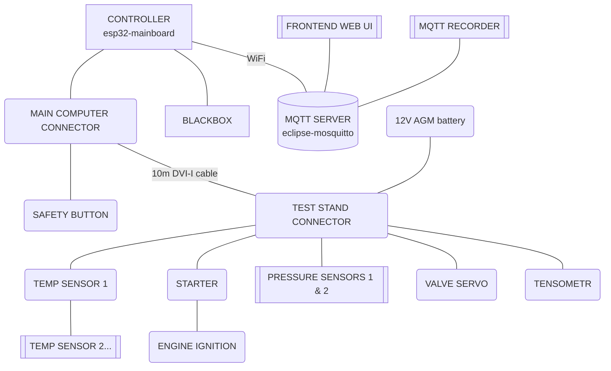

Rakieta
=======

Hardware, firmware and ground software for a rocket engine test stand: sensing, valve and
ignition control, live telemetry, and a crash-survivable blackbox recorder.

## Documentation

Operator guides, in the order you need them:

| Guide | Covers |
| --- | --- |
| [docs/setup.md](docs/setup.md) | network layout, starting the broker and frontend, configuring and flashing the controller, publishing the firmware ELF |
| [docs/calibration.md](docs/calibration.md) | what the conversion settings mean, how to calibrate, where the calibration is stored, how not to lose it |
| [docs/blackbox.md](docs/blackbox.md) | preparing the SD card, verifying that the blackbox records, reading the data back |
| [docs/data-and-history.md](docs/data-and-history.md) | MQTT recording and replay, the frontend's history, CSV export, controller reboots |
| [docs/experiment.md](docs/experiment.md) | preparing for a test firing, the controller's states, archiving the data |
| [docs/checklists.md](docs/checklists.md) | the procedure for a hot fire day, step by step: the eight lists of the frontend's CHECKLIST tab |

Developer notes live next to the code: `frontend/DEV.md`, `esp32-mainboard/DEV.md`,
`blackbox-firmware/DEV.md`.

## Quick start

```bash
git submodule update --init --recursive
docker compose up --build -d          # broker :1883 / :8000, recorder, frontend :3000

cd esp32-mainboard
cp .env.example .env                  # set WIFI_SSID, WIFI_PASSWORD, MQTT_HOST
cargo run --release --bin test-stand-controller
cd ..

scripts/publish-test-stand-elf.sh \
  esp32-mainboard/target/riscv32imac-unknown-none-elf/release/test-stand-controller
```

Then open `http://localhost:3000`, click the gear icon and **CONNECT**. Details and
verification steps are in [docs/setup.md](docs/setup.md).

## Five things that lose data

1. The broker's retained state (firmware ELF, calibration, checklist) lives in a Docker
   volume. `docker compose down -v` deletes it; keep exported copies.
2. The calibration lives in the browser and on the broker. Export it to a file after every
   change.
3. A blackbox that still runs firmware from before the append fix starts writing at the
   beginning of the card every time it powers up. Reflash it, or take the card out before
   powering it again.
4. The frontend's history lives in one browser. Export the CSV; clearing the browser's site
   data deletes it.
5. The firmware ELF must match the flashed build exactly. Publish it again after every flash.

## Subprojects

| Directory | Contents |
| --- | --- |
| `esp32-mainboard/` | controller firmware (ESP32-C6, Rust), git submodule on branch `teststand`; also the host tools `tools/blackbox-decoder` and `tools/defmt-mqtt-decoder` |
| `frontend/` | web UI for telemetry, control, checklists and calibration; talks MQTT over WebSocket |
| `blackbox-firmware/` | firmware for the blackbox recorder (STM32C011) |
| `blackbox/` | blackbox PCB: UART to SD card logger |
| `connector-main-computer/` | connector board at the controller; aggregates its I/O onto a 10 m DVI-I cable |
| `connector-test-stand/` | connector board at the stand; splits the cable out, provides power, analog front ends and actuator drivers |
| `starter/` | ignition board with I2C IO expander and safety comparator |
| `sensor-tmp107/` | TMP107 temperature sensor PCB, chainable on one bus |
| `scripts/` | `publish-test-stand-elf.sh`, and two ways to replay a recording: `replay-mqtt.py` (fast) and `replay-mqtt.sh` (no Python needed) |
| `recordings/` | MQTT recordings written by the `mqtt-recorder` service (not in git) |
| `shared/` | logo files and footprints |

The PCB directories are KiCad projects; each has a README with a picture and the schematic
PDF.

## Hardware connections



## MQTT topics

Broker: Mosquitto, anonymous, MQTT on TCP `1883` and MQTT over WebSocket on `8000`.
`mosquitto.conf` raises `max_packet_size` to 20 MB so that the firmware ELF fits in one
message. All integers are little-endian; timestamps are milliseconds since the controller
booted.

Published by the controller:

| Topic | Retained | Payload |
| --- | --- | --- |
| `sensor/adc/fast/tensometer`, `sensor/adc/fast/pressure/tank`, `sensor/adc/fast/pressure/combustion` | no | `u32` first timestamp, `u32` last timestamp, packed 12-bit raw ADC samples (100 per message, 1 ms apart) |
| `sensor/adc/slow/battery/stand`, `…/battery/computer`, `sensor/adc/slow/boost_voltage`, `…/starter_sense` | no | `u32` timestamp, `u16` raw ADC |
| `sensor/temp/<n>` | no | `u32` first timestamp, `u32` last timestamp, `u16` raw readings |
| `sensor/digital/armed` | yes | `u32` timestamp, `u8`: 1 = safety switch armed, 0 = safe |
| `sensor/servo` | yes | `u32` timestamp, `u16` pulse ticks (500 = 0°, 2500 = 180°) |
| `status/state` | yes | `ARMED`, `COUNTDOWN`, `FIRE`, `POSTFIRE`, `LAMPTEST`, `CAMERATEST` |
| `status/servo` | yes | `CLOSED`, `OPENING`, `OPEN`, `CLOSING` |
| `metric/cpu/idle` | yes | `u16` idle time in permille |
| `metric/wifi/rssi` | yes | `i32` dBm |
| `log/defmt` | no | raw `defmt` log bytes; decoding needs the firmware ELF |

Commands to the controller (never retained):

| Topic | Payload |
| --- | --- |
| `cmd/state` | `FIRE`, `ABORT`, `FIRE_END`, `FIRE_RESET`, `LAMP_TEST`, `CAMERA_TEST` |
| `cmd/servo` | `OPEN`, `CLOSE` |
| `cmd/shutdown` | `SHUTDOWN` |

Shared state kept on the broker (retained, persisted in the `mosquitto-data` volume):

| Topic | Written by | Payload |
| --- | --- | --- |
| `shared/firmware/test_stand_controller/elf` | `scripts/publish-test-stand-elf.sh` | the firmware ELF, raw bytes |
| `config/conversions/state` | frontend | calibration, JSON |
| `checklist/<checklist>/points/<point>/state` | frontend | checklist step state, JSON |

The controller sends raw readings on purpose: conversion happens in the frontend, so a wrong
calibration can be corrected afterwards by replaying the recording.
