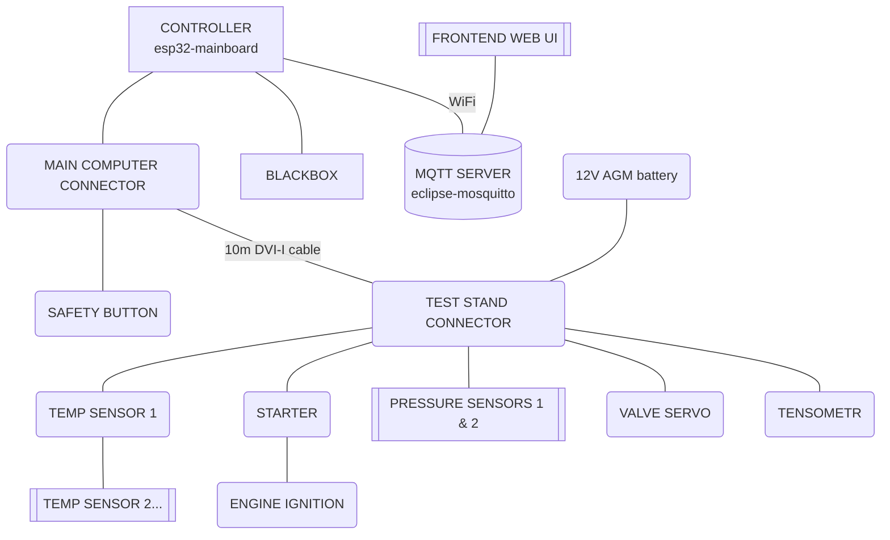

Rakieta hardware
================

This repository contains the hardware and firmware for the rocket engine test project. It groups several PCBs and related firmware used for sensing, control distribution, ignition, and a crash-survivable blackbox recorder.

Subprojects

- `blackbox/`: Blackbox PCB (stores UART data to SD card)
- `blackbox-firmware/`: Firmware for the blackbox recorder
- `connector-main-computer/`: Connector board near controller that aggregates GPIO to a 10m DVI-I cable
- `connector-test-stand/`: Connector board at the test-stand end; decomposes signals, provides power, analog preprocessing, and actuators
- `esp32-mainboard/`: ESP32-C6 controller firmware as a git submodule on the `teststand` branch
- `frontend/`: Web UI for telemetry visualization and command/control; connects to MQTT over WebSocket
- `sensor-tmp107/`: TMP107 temperature sensor PCB (chainable via SMAART wire bus)
- `starter/`: Ignition starter board with I2C IO expander and safety comparator

Connection graph (Mermaid)



MQTT communication

- Broker: Mosquitto (`docker-compose.yml` service `mqtt`)
- Recorder: `mqtt-recorder` service dumps all traffic to `recordings/` (see below)
- Frontend: Docker Compose also launches the web dashboard on `http://localhost:3000`
- Controller (`esp32-mainboard`) publishes telemetry and receives command topics via MQTT
- Controller also publishes raw `defmt` log bytes on `log/defmt`
- The matching firmware ELF is shared as retained raw bytes on
  `shared/firmware/test_stand_controller/elf`
- Frontend connects to the same broker via WebSocket (`ws://<host>:8000`) and subscribes/publishes control topics
- MQTT TCP port: `1883` (standard MQTT)
- MQTT WebSocket port: `8000` (used by frontend)
- `mosquitto.conf` raises `max_packet_size` to `20000000` so the retained
  `shared/firmware/test_stand_controller/elf` payload can carry the matching firmware ELF

Publishing the retained ELF

Use the helper script after building the matching controller firmware ELF:

```bash
scripts/publish-test-stand-elf.sh \
  esp32-mainboard/target/riscv32imac-unknown-none-elf/debug/test_stand_controller
```

Set `MQTT_HOST`, `MQTT_PORT`, `MQTT_USERNAME`, `MQTT_PASSWORD`, or `MQTT_TOPIC` if you need
non-default broker settings.

Recording and replaying MQTT traffic

The `mqtt-recorder` compose service subscribes to `#` and appends every message to
`recordings/<UTC timestamp>.tsv`. Each container start opens a new file, so restarting the
service (or the broker, which makes the recorder exit and restart) starts a new recording.
The directory is gitignored.

Each line holds one message, five tab-separated fields:

```
<unix time with ns>\t<topic>\t<qos>\t<retain>\t<payload as hex>
```

Payloads are hex because most topics carry raw binary. The retain flag is the publisher's
(MQTT v5 retain-as-published), so retained state can be reproduced. Every retained message,
including the ~12 MB firmware ELF, lands in the file at every recorder start.

Replay a recording into a broker with:

```bash
scripts/replay-mqtt.sh recordings/20260906T155835Z.tsv
```

It publishes every line to its original topic with the original QoS and retain flag, as
fast as the broker accepts (roughly 500 messages per second). Timestamps are ignored; the
frontend orders data by the timestamps inside the payloads. Set `MQTT_HOST` and `MQTT_PORT`
for a non-default broker.

- Messages on `cmd/#` are never replayed: a connected controller would execute them.
- Clear the browser database before replaying. The frontend rejects packets older than
  its last stored timestamp as time travel, and recordings from another controller boot
  are older.
- Retained frontend state (`checklist/*`, `config/conversions/state`) is replayed too and
  overwrites the current broker state with the recorded one.
- The recorder is running during replay, so the replay itself becomes a new recording.

Running with Docker Compose

```bash
git submodule update --init --recursive
docker compose up --build
```

The frontend is available at `http://localhost:3000`. The MQTT broker exposes TCP MQTT on
`1883` and WebSocket MQTT on `8000`.

Notes

- This repo is intended for hardware files (KiCad projects), gerbers and firmware sources related to the test-stand and engine instrumentation.
- See subdirectory READMEs for purpose and quick pointers to major files.
